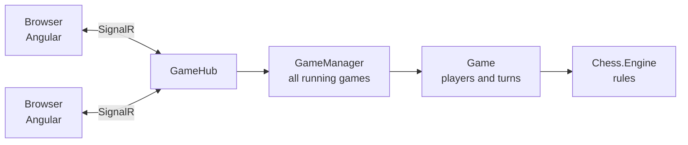

# Chess Online

[](https://github.com/Moshik520/chess-online/actions/workflows/ci.yml)

A chess game you play in the browser against a friend. One player creates a game and gets a short code, the
other joins with it, and every move shows up on both boards right away.

The rules engine is written from scratch in C#, and the server is the only side that knows the rules: the
browser draws the board and sends moves, and the server checks every move before it is played.

Built with C# (.NET 10), ASP.NET Core, SignalR, Angular, xUnit and Vitest.

## Features

- Create a game and share the code, or join a friend's game with theirs
- Click a piece to see where it can go, then click the target square
- The board turns around for the player with the black pieces
- The last move is highlighted on both boards
- Pick the piece when a pawn promotes
- All the rules: castling, en passant, promotion, check, checkmate and stalemate
- If your opponent closes the tab, you are told and can go back to the lobby

## How it works



The solution has three parts:

- `src/Chess.Engine` is a class library with no dependencies. It holds the board, reads and writes FEN, and
  generates legal moves.
- `src/Chess.Server` is an ASP.NET Core app with one SignalR hub. `Game` checks whose turn it is and who is
  allowed to move, `GameManager` keeps all the games that are running, and the hub passes messages between
  the two browsers and the game.
- `src/chess-web` is the Angular client. `GameService` owns the SignalR connection and exposes the game state
  as signals, and the board component only draws a FEN string and reports clicks.

Moves travel as UCI strings (`e2e4`, `e7e8q`) and positions as FEN, the same formats chess engines use.

### Problems I ran into

- Legal moves are found by trying each candidate move on a copy of the board and throwing it away if it
  leaves my own king in check. That one check covers pins, moving into check, double check and the rare case
  where an en passant capture removes two pawns from a rank and opens it to a rook.
- Castling needs to know whether the squares the king passes are attacked. Attack detection asks every enemy
  piece for its moves, so if the king's move list included castling, the two would call each other forever.
  Castling is added only in the legal move step, which nothing else calls.
- A pawn's move list is the wrong answer to "is this square attacked": it includes the push forward, which
  never attacks, and leaves out a diagonal onto an empty square, which does. Pawns get their own check.
- Two moves can reach the server at the same moment, so `Game` locks around the check of whose turn it is and
  the move itself.
- I didn't want the rules written twice. Instead of a second engine in TypeScript, the browser asks the
  server for the legal targets of the piece you click.

## Tests

| Project | What it covers | Tests |
|---|---|---|
| `tests/Chess.Engine.Tests` | Move generation for every piece, check, castling, en passant, FEN and UCI | 112 |
| `tests/Chess.Server.Tests` | Turn and player rules, and the hub over real SignalR connections | 25 |
| `src/chess-web` | Board and lobby components | 15 |

The engine is checked with perft: counting every position reachable to a given depth and comparing with the
published numbers, for the starting position (197,281 positions at depth 4) and four well-known test positions.
Any mistake anywhere in the rules changes those counts.

The server tests start the real app in memory with `WebApplicationFactory`, connect two SignalR clients and
play through it, including a full game ending in checkmate and a player disconnecting.

## Running it locally

You need the .NET 10 SDK and Node.js 24.

```bash
dotnet run --project src/Chess.Server     # server on http://localhost:5001

cd src/chess-web
npm ci
npx ng serve                              # client on http://localhost:4200
```

Open http://localhost:4200 in two windows, create a game in one and join it from the other.

To run the tests:

```bash
dotnet test
cd src/chess-web && npx ng test --watch=false
```
